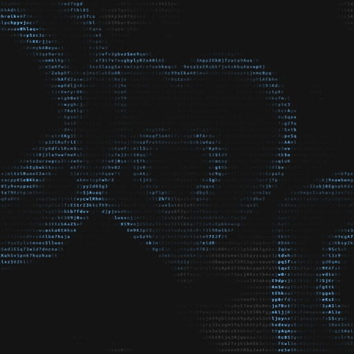

# 字符流光 Character Flow

一款 [Wallpaper Engine](https://store.steampowered.com/app/431960/) 网页壁纸：满屏细小字符组成的烟雾，随风缓缓往右下飘。

## 效果

- **背景**：灰色字符组成的细长烟团，随风缓缓漂移，字符不断变换。
- **鼠标滑动**：在同一处来回划会慢慢搅出一片字雾，停下后逐渐散去。
- **鼠标点击**：出现蓝色圆环，按「圆、圆、爱心」的顺序循环。圆环沿着灰字向外扩散，会带着一部分灰字一起走，之后碎开、褪成灰色消失。

颜色、字符大小、烟量、鼠标雾的浓淡和消散时间、圆环的大小、速度、亮度、分散度都可以在 Wallpaper Engine 的设置面板里调整。

## 安装

1. 下载本仓库（右上角 **Code → Download ZIP**），解压。
2. 打开 Wallpaper Engine，点左下角 **打开壁纸 → 从文件打开**，选择解压出来的 `wallpaper-engine/project.json`。
3. 想让鼠标滑动和点击有反应：在 Wallpaper Engine 的 **设置 → 常规** 里打开鼠标输入相关选项（设置里允许壁纸接收鼠标）。

字体用的是 Ubuntu Mono，电脑上没装的话会自动改用 Consolas，效果差别不大。

## 文件说明

| 路径 | 内容 |
|---|---|
| `wallpaper-engine/project.json` | 壁纸信息和设置面板 |
| `wallpaper-engine/index.html` | 入口页面 |
| `wallpaper-engine/js/config.js` | 所有参数的默认值 |
| `wallpaper-engine/js/smoke.js` | 烟雾模拟（背景烟、鼠标雾） |
| `wallpaper-engine/js/ripple.js` | 点击圆环 |
| `wallpaper-engine/js/main.js` | 每帧主循环 |
| `wallpaper-engine/js/render.js` | 把字符画到屏幕上 |
| `wallpaper-engine/js/settings.js` | 接收设置面板的改动 |

## 说明

灵感来自 Claude 桌面应用的背景动画。本壁纸为个人仿制的非官方作品，与 Anthropic 无关。
